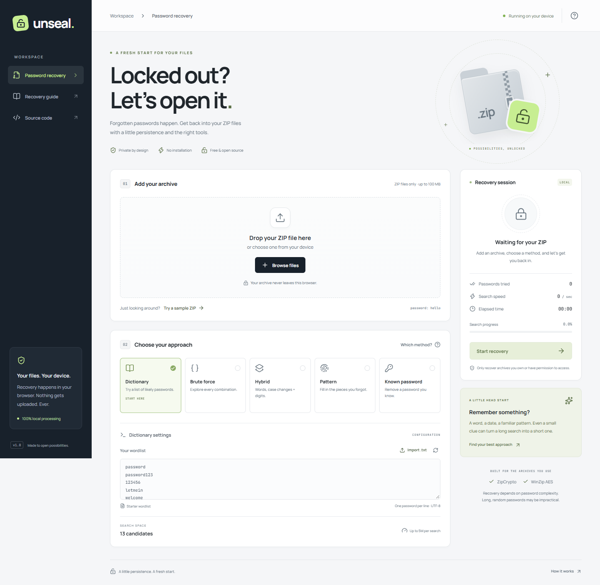

# Unseal — ZIP Password Recovery

A fresh start for locked files. A modern, private ZIP password recovery app built with React, TypeScript and Vite. Drop an archive, choose a search method, recover its password and download an unlocked ZIP. All recovery runs locally in a browser worker.



## Features

- **Dictionary:** edit a wordlist or import a UTF-8 `.txt` file. Duplicates and blank lines are removed; password whitespace is preserved.
- **Brute force:** configurable character sets and length bounds; candidates are generated lazily, shortest first.
- **Hybrid:** original, lowercase, uppercase and capitalized words, followed by fixed-width numeric suffixes.
- **Pattern:** combine remembered text with `?d` digits, `?l` lowercase, `?u` uppercase, `?s` symbols, or `??` for a literal question mark. For example, `summer?d?d` tries `summer00` through `summer99`.
- **Known password:** remove protection with a password you already know.
- ZipCrypto and WinZip AES support, real progress, measured speed, immediate cancellation, password copying and unlocked ZIP downloads.
- Responsive navy-and-lime interface, locally bundled Manrope and JetBrains Mono fonts, keyboard method selection and an accessible recovery guide.
- Built-in AES sample archive with password **`hello`**.

## Run locally

Requires **Node.js 24+** and npm.

```sh
git clone https://github.com/NorihyDev/zip-file-password-unlocker.git
cd zip-file-password-unlocker
npm ci
npm run dev
```

Open the localhost URL printed by Vite. Select **Try a sample ZIP**, then **Start recovery** to try the entire flow.

```sh
npm run build    # TypeScript checks and production build in dist/
npm run preview  # Serve the production build locally
```

The app is a static site. Serve `dist/` over HTTP or HTTPS using a static host; opening `index.html` directly with `file://` does not support module workers. The relative Vite base supports hosting in a subdirectory.

## How recovery works

1. Read the archive directory and check file paths, entry count and expanded size.
2. Generate candidates without allocating the entire search space.
3. Decrypt the smallest encrypted file and verify its decoded contents, CRC and AES authentication where applicable. Header matches alone are insufficient for ZipCrypto.
4. For a matching candidate, verify every archive entry and build a new ZIP without encryption. A candidate that fails on another entry is rejected.
5. Offer the recovered password and unlocked archive for download. The original archive is unchanged.

The ZIP implementation uses [zip.js](https://gildas-lormeau.github.io/zip.js/). A dedicated Web Worker keeps the interface responsive. Stopping a search terminates the worker; restarting begins a new search.

## Privacy and practical limits

ZIPs, dictionaries, candidate passwords and recovered contents are held in browser memory. The app has no upload endpoint, analytics, remote fonts, account system or persistent recovery storage. Reloading clears the session. Normal static hosting requests still retrieve the application assets.

| Limit                           | Maximum                     |
| ------------------------------- | --------------------------- |
| Input ZIP                       | 100 MiB                     |
| Total expanded content          | 200 MiB                     |
| Archive entries                 | 2,000                       |
| Candidates per search           | 5,000,000                   |
| Dictionary import               | 5 MB / 100,000 unique words |
| Password length for brute force | 1–12 characters             |
| Hybrid numeric suffix           | 1–3 digits                  |

The app performs a **single-worker CPU search**. It is suitable for remembered patterns, likely passwords and short search spaces. It does not guarantee recovery or bypass encryption. Long, random passwords can be impractical, especially with AES. There is no GPU acceleration, distributed search, pause/resume, saved sessions or built-in large wordlist. RAR, 7z, split archives and archives with different passwords per entry are unsupported. Archive formats and metadata unsupported by zip.js may also fail. Files and directory structure are preserved, but the rebuilt ZIP does not promise byte-identical compression or every original metadata field. Rebuilt entries use store mode, so downloads may be larger than the input.

Only recover archives you own or are authorized to access.

## Verification

```sh
npm test
npm run build
npm run test:e2e
npm run format:check
```

Local browser tests use installed Google Chrome. GitHub Actions installs Playwright Chromium. Tests cover candidate generation, real AES and ZipCrypto recovery, unencrypted output verification, all five methods, sample downloads, malformed archives, cancellation, search limits, desktop/mobile layout, accessibility and absence of external requests during sample recovery.

```sh
npm run format # Format source and configuration
```

## Project structure

```text
src/App.tsx              Recovery workspace and UI state
src/styles.css           Responsive design
src/recovery.worker.ts   Background search and ZIP rebuilding
src/lib/archive.ts       ZIP validation, verification and unlocking
src/lib/candidates.ts    Lazy candidate generation and search limits
src/lib/protocol.ts      Typed worker messages
tests/recovery.test.ts   Engine and archive tests
tests/e2e/app.spec.ts    Desktop and mobile browser tests
```

## License

[MIT](LICENSE). Created by [NorihyDev](https://github.com/NorihyDev).
